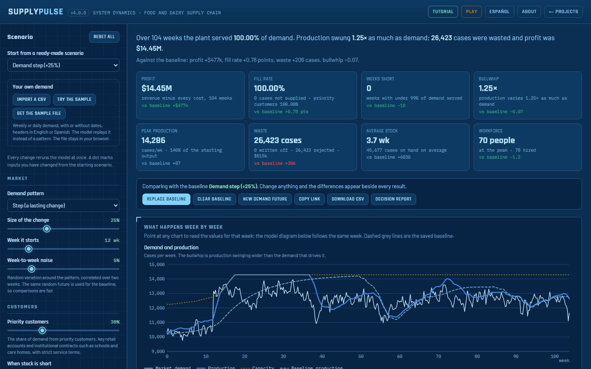

# PharmaSim — Pharmaceutical Supply Chain Dynamics

**Live: [kathuman.github.io/pharma-sim](https://kathuman.github.io/pharma-sim/)** · [About](https://kathuman.github.io/pharma-sim/about.html) · English and Latin American Spanish

A system-dynamics simulator of a pharmaceutical supply chain. Shock the market or the plant, add a distributor,
pull a lever or change the planning policy, and see the effect on profit, service, the bullwhip effect and waste
against a saved baseline. A three-level tutorial (beginner, intermediate, advanced) walks through it.

## What is in the model

- **Market demand**: steady, a lasting step, a surge, or seasonal, with pink week-to-week noise from a seeded
  generator. The baseline sees the same random future, so a difference is never luck.
- **Plant**: production is the workforce times productivity, capped by the equipment. The workforce follows the
  plan with a hiring delay, and people leave over time. Overtime can add capacity, with a premium paid only on the
  extra packs.
- **Campaigns** (optional): the line is shared with other products. Each campaign starts with a changeover, which
  costs capacity. A change of plan reaches the line half a campaign later, on average, and half a campaign of cycle
  stock is added to the target.
- **API supplier** (optional): the plant needs the active ingredient for every pack. It orders from a supplier with a
  long lead time and limited capacity, which can stop shipping for weeks. Production slows once less than a week of
  API is on hand.
- **QA release**: a three-stage delay with a rejection rate, limited by what the lab can test each week, so in a
  surge the lab can become the bottleneck. QA can be expedited when stock is low: faster, with extra lab shifts, but
  it costs money per pack and brings more deviations.
- **Shelf life**: finished goods are kept by age and shipped oldest first. A pack older than its shelf life minus
  the remaining life customers require at delivery is written off.
- **Service**: everything ships while the plant holds at least two weeks of stock. Below that, service falls
  smoothly, because stock is spread over many presentations and markets.
- **Patients**: a share of demand is critical (hospitals, no substitute). When stock is short, an allocation rule
  shares it in proportion or serves critical patients first, and a critical shortage can carry a higher penalty.
- **Distributor tier** (optional): its own stock, forecast and ordering rule, a backlog at the plant, transit in
  between, and the option to share sales data with the plant.
- **Planning**: the forecast, plus a correction for the stock gap, plus a weight on the supply line (stock in QA,
  and what the distributor has on order).
- **Money**: the plant's profit. Revenue, minus materials, wages, hiring, overtime, holding, disposal, expediting,
  and a penalty for each pack not supplied.
- **Results**: fill rate, weeks short, bullwhip (standard deviation of production ÷ standard deviation of demand,
  plus the same ratio for the distributor's orders), waste, average stock and workforce.

The page shows every equation with its value in any week, and a live stock-and-flow diagram.

## What the tests check

`node tests/model.test.js` (114 checks):
- Every structure starts in exact balance, and every pack is accounted for in every scenario.
- Halving and quartering the time step gives the same answers, and the noise has the chosen size at any step.
- The forecast matches its exact solution.
- Each lever produces its trade-off. For example, overtime ends the shortage after a demand step, but for a
  short-life product it makes more stock expire.
- Every unit of API is accounted for, and the QA lab never releases more than it can test.
- The model can be advanced in pieces, giving exactly the same run, and a fixed plan can replace the planning rule
  (for the coming play mode).

`node tests/tutorial.test.js` (331 checks):
- Every claim the tutorial's questions make holds in the model.
- Every step points at a real element and quotes only known numbers.
- Every step has a Spanish version with the same shape.

`node tests/i18n.test.js` checks the Spanish translation for completeness, including the validation messages.

CI runs all three on every push.

## Run it

Plain JavaScript with no build step: serve the folder with any static server (`python -m http.server`) and open
`index.html`.

## Version history

- **3.0.0**: pharma realism.
  - An API supplier tier, with a lead time, capacity and outages.
  - Campaign production with changeovers and cycle stock.
  - QA lab capacity.
  - Critical patients, with an allocation rule.
  - Warnings for settings that will keep stock expiring.
  - Four new case presets: an API supplier outage, a biologic, a generic antibiotic and a pandemic vaccine.
  - Seven new tutorial steps, in English and Spanish.
  - With the new features off, every v2 result is reproduced exactly.
- **2.0.0**: a complete rebuild.
  - A tested model fixes v1's problems: the bullwhip measure counted expiry replacement as amplification, and
    noise was redrawn on every change, so comparisons weren't fair.
  - Fill rate barely moved and the levers rarely paid off. Shelf life, a distributor backlog and the supply-line
    weight are now modelled, and the levers make real trade-offs.
  - New: a tutorial in three levels, the full app in Spanish, an About page, and the blueprint theme shared with
    the Warehouse Model.
  - The page no longer compiles itself in the browser: no React, Babel or Tailwind CDN.
- **1.x**: the original React dashboard.

---

Daniel Alberto Sepulveda Estay, PhD · [Estay Dynamics](https://kathuman.github.io/estay-dynamics/): system
dynamics and supply chain network design.
